<p align="center">
  <picture>
    <source media="(prefers-color-scheme: dark)" srcset="docs/assets/banner-dark.png">
    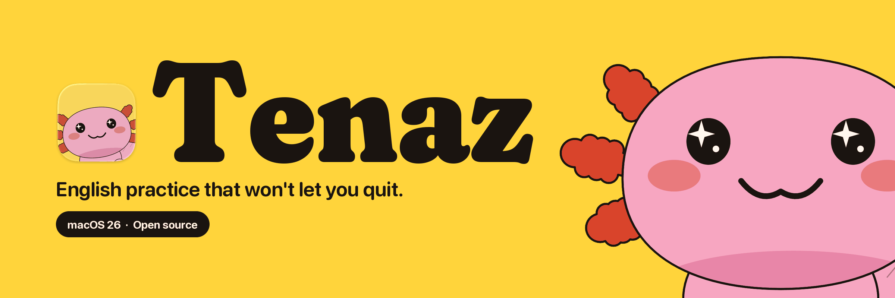
  </picture>
</p>

<p align="center">
  <b>A native Mac app for learning English, with a mascot that nags.</b><br>
  Spaced repetition, TOEFL-style exams and opt-in interruptions you choose for yourself. Everything runs on your Mac.
</p>

<p align="center">
  <a href="https://github.com/Chere3/tenaz/actions/workflows/ci.yml"></a>
  
  
  <a href="LICENSE"></a>
  <a href="CONTRIBUTING.md"></a>
</p>

<p align="center">
  <a href="#features">Features</a> ·
  <a href="#screenshots">Screenshots</a> ·
  <a href="#safety-by-design">Safety</a> ·
  <a href="#build-from-source">Install</a> ·
  <a href="#architecture">Architecture</a> ·
  <a href="#research">Research</a> ·
  <a href="#contributing">Contributing</a>
</p>

## What it is

Most language apps wait for you to open them. Tenaz comes to you. It is built for Spanish-speaking professionals at B1+ who need English for work meetings, and for learners with ADHD who drop apps that stay quiet. You decide how pushy it gets: word quizzes over your desktop, a short writing prompt after you unlock the Mac, and penalties you set in a written contract. Tena, an axolotl, grows only when your English does. A TOEFL-style placement test sets your starting level, and all data stays in a local SQLite file.

<p align="center">
  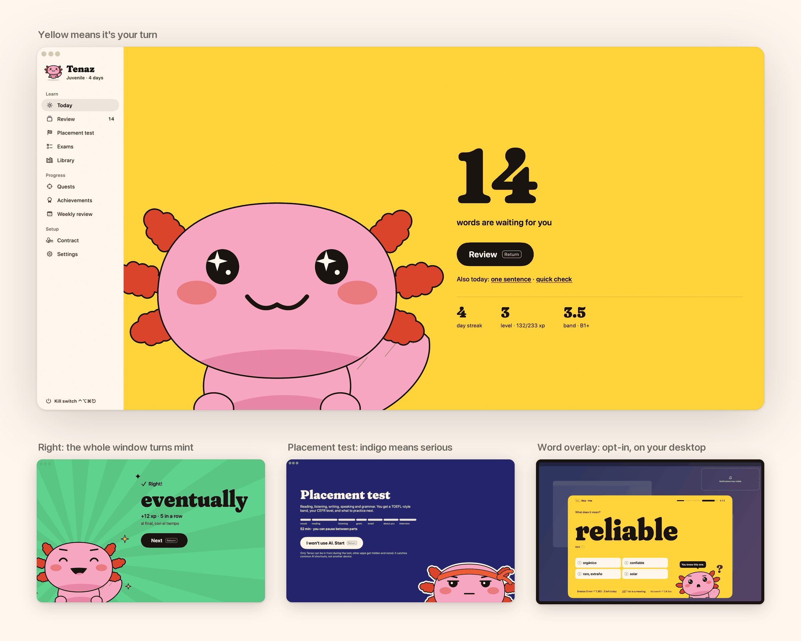
</p>

## Features

**Daily practice**
- Vocabulary scheduled by an FSRS-6 port, checked against golden vectors generated with py-fsrs 6.3.2.
- 1,913 vocabulary notes in 17 files: workplace and meeting phrases, false friends, phrasal verbs, NGSL, NAWL and BSL headwords, with Spanish glosses.
- Typed recall, cloze and multiple choice. Answers are rated from what you type and how fast. There is no self-rating.
- A Write screen and a Library with 65 catalogued books and podcasts and 30 short "Brain bite" reading cards.

**Exams**
- Placement test: 7 sections (vocabulary, reading, listening, grammar, an email, writing about you, a spoken interview), 52 minutes, with pauses allowed between parts.
- Daily Check, Weekly Mock and Monthly Mock blueprints in [`Content/config/blueprints.json`](Content/config/blueprints.json).
- 6,035 exam and practice items in 41 files, modeled on the 2026 TOEFL iBT task types, plus IELTS-style cue cards and essays.
- Ability is estimated per skill with a Rasch (1PL) model. Results show a TOEFL-style band, a CEFR level and an approximate IELTS band.
- Writing and speaking transcripts are graded against a rubric by the `claude` CLI, after you submit and never during the exam.

**Listening**
- Spoken items play local Kokoro-82M neural voices from a pre-rendered cache.
- The audio is not in the repository. Without it, each item falls back to the macOS system voice. See [Voices](#optional-neural-voices).

**Intrusions you opt into** (all off by default)
- Word overlays: a batch of 3 quick questions over your desktop. At most 8 a day, at least 40 minutes apart.
- Unlock gate: after the Mac was locked for 30+ minutes, write 25 to 40 words using a target phrase. At most 3 a day, 2 hours apart.
- Contract: penalties you pick (Vitality loss, repair tasks, a stricter gate). Tightening waits until the next day; loosening waits 24 hours.
- Penalties are capped at -30 Vitality a day. After 3 penalty events in a day, Tenaz switches to recovery mode.

**Tena**
- 12 moods, from ecstatic to asleep, driven by what you did today.
- 8 growth stages from Egg to Metamorph. From stage 4 on, growth needs mastered words and a verified exam band. Stages never regress.
- A menu bar glyph shows her state. While the main window is open, the Dock icon is redrawn with her current mood.
- 53 achievements, daily quests and a weekly review.

**Exam integrity**
- In every answer field, paste is blocked and Writing Tools, inline predictions and autocorrect are off.
- During an exam only Tenaz may be in front. Any other app is hidden and logged.
- Optional witness: after an exam, Tenaz reads the activity log of [Tivra](docs/research/06-tivra-integration.md), the author's Mac activity tracker, read-only. Without Tivra, results are marked Unverified. They still update your practice estimate but do not count toward the verified band.

## Screenshots

<table>
  <tr>
    <td width="50%">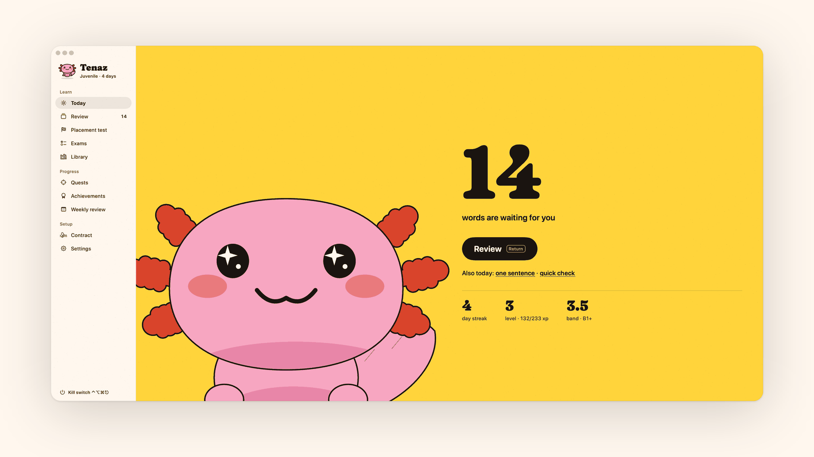<br><sub><b>Home.</b> Yellow means it's your turn. One number, one button.</sub></td>
    <td width="50%">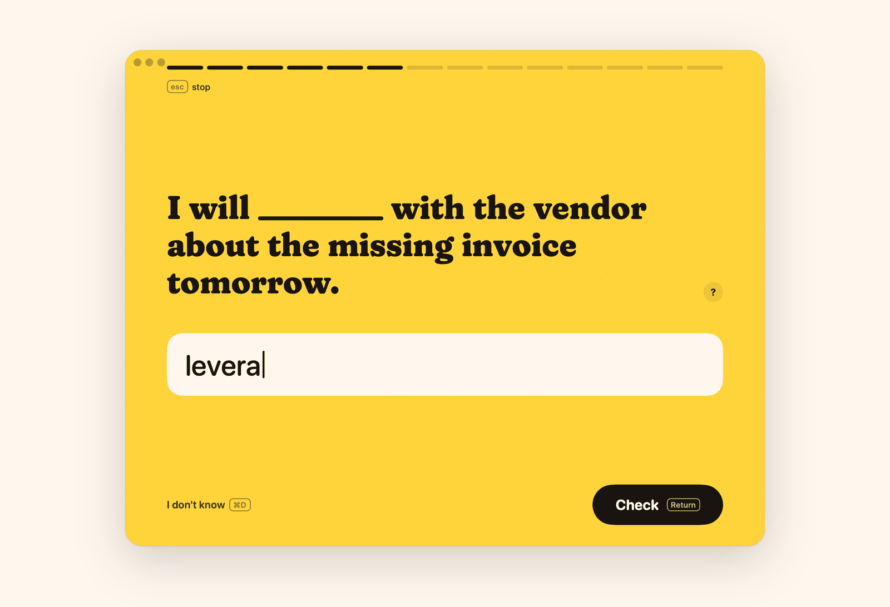<br><sub><b>Review.</b> Typed recall in a sentence, with an "I don't know" way out.</sub></td>
  </tr>
  <tr>
    <td>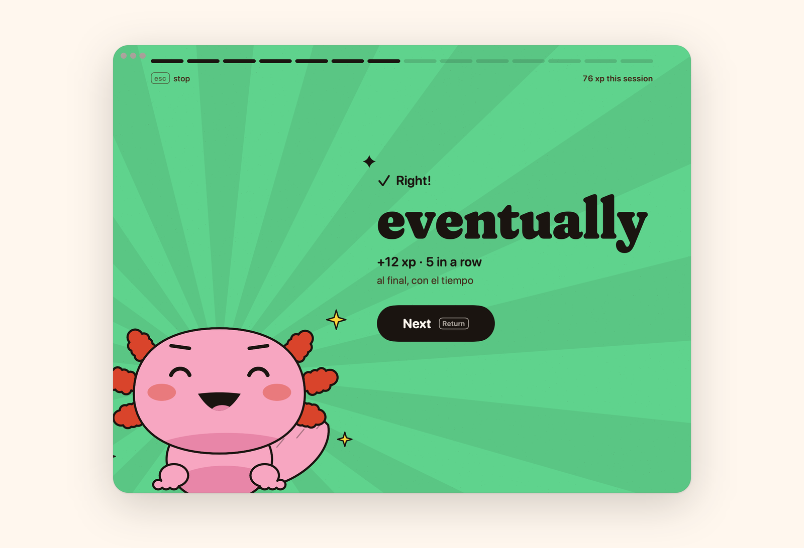<br><sub><b>Right answer.</b> The whole window turns mint. XP and combo.</sub></td>
    <td>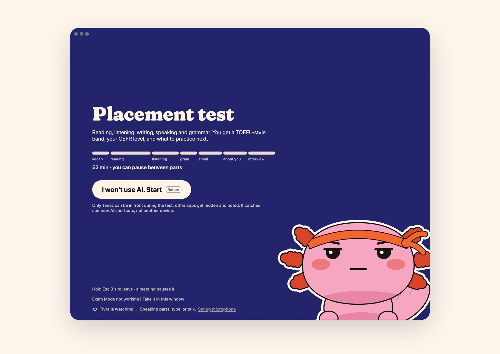<br><sub><b>Placement test.</b> 7 sections in 52 minutes. Indigo means exam.</sub></td>
  </tr>
  <tr>
    <td>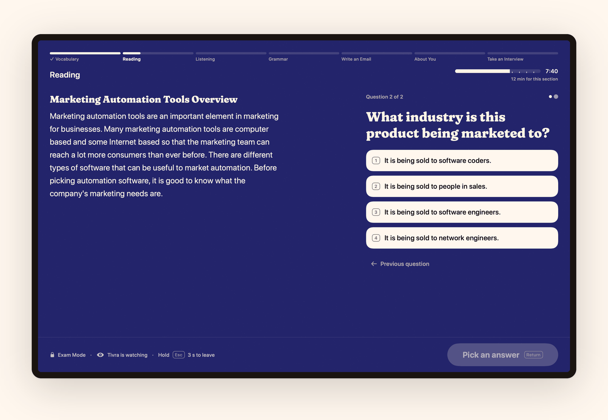<br><sub><b>Reading.</b> Full screen, passage beside the question, timer on top.</sub></td>
    <td>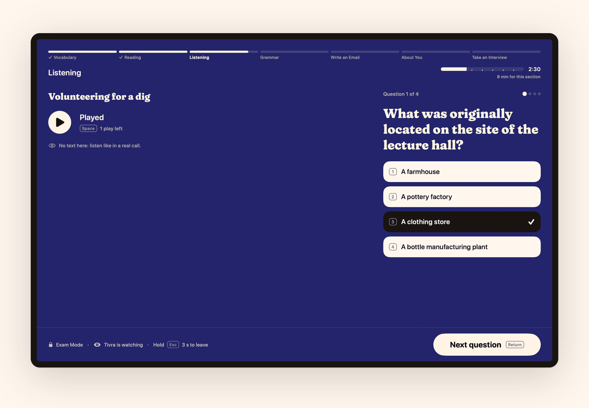<br><sub><b>Listening.</b> Limited plays, like the real test.</sub></td>
  </tr>
  <tr>
    <td>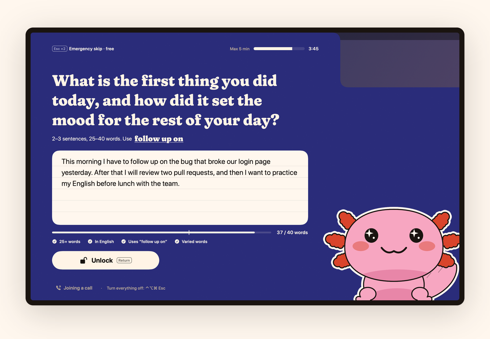<br><sub><b>Unlock gate.</b> Two or three sentences with a target phrase. The top-right corner stays open so notifications remain visible.</sub></td>
    <td>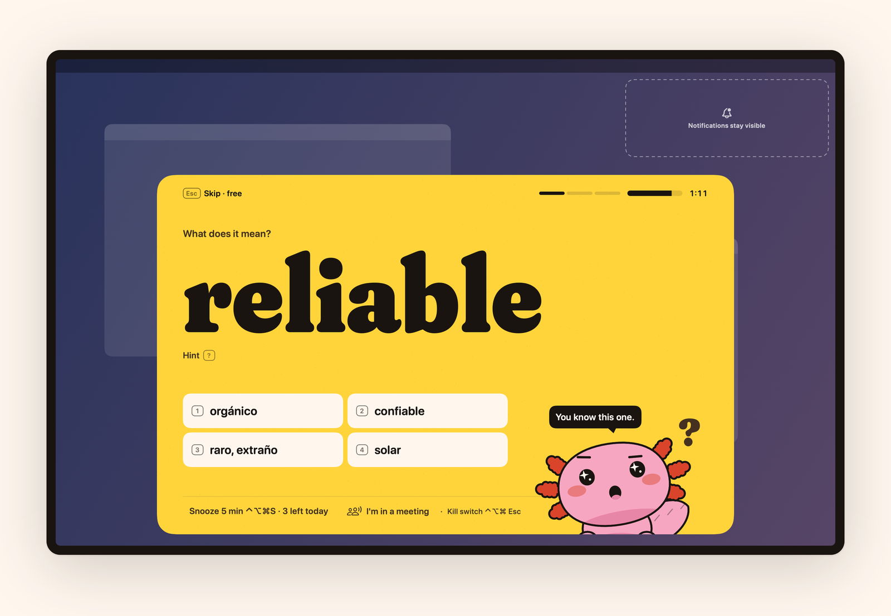<br><sub><b>Word overlay.</b> Snooze, "I'm in a meeting" and the kill switch are always on the card.</sub></td>
  </tr>
  <tr>
    <td>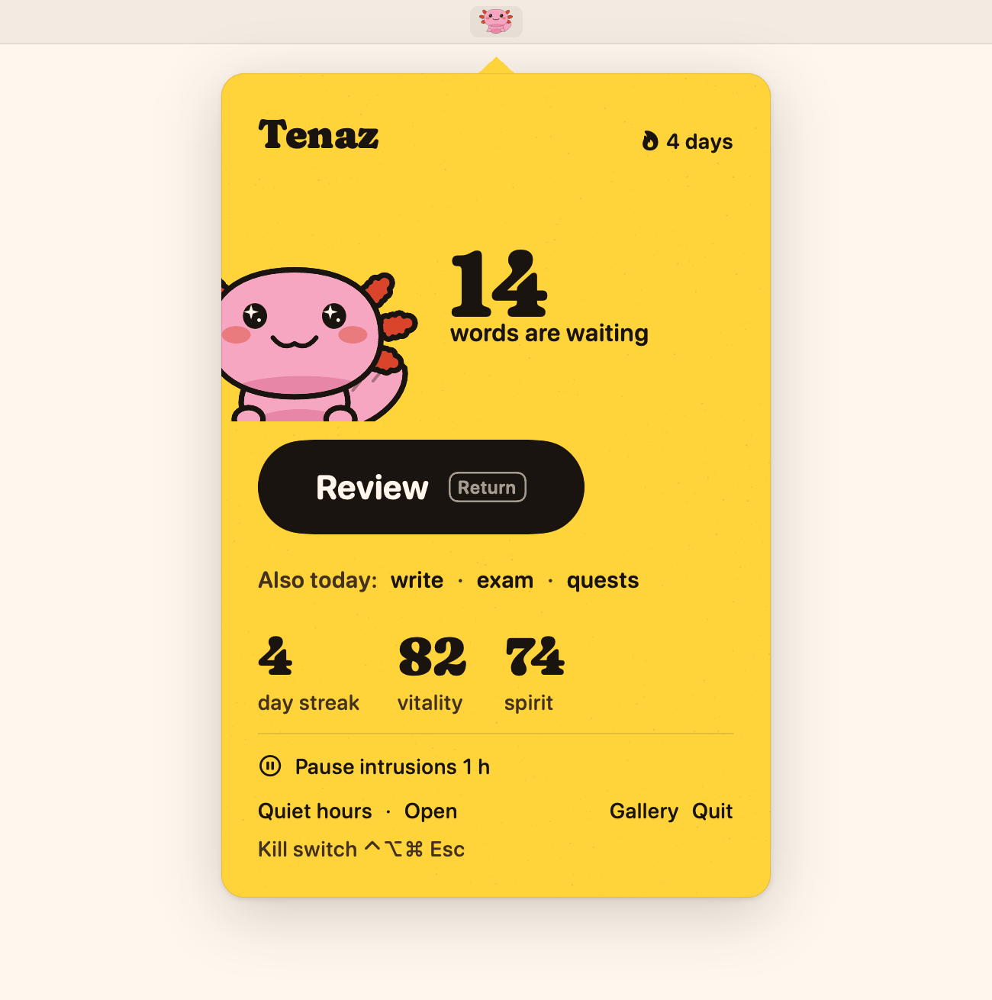<br><sub><b>Menu bar.</b> Due words, streak, Tena's meters and "Pause intrusions".</sub></td>
    <td>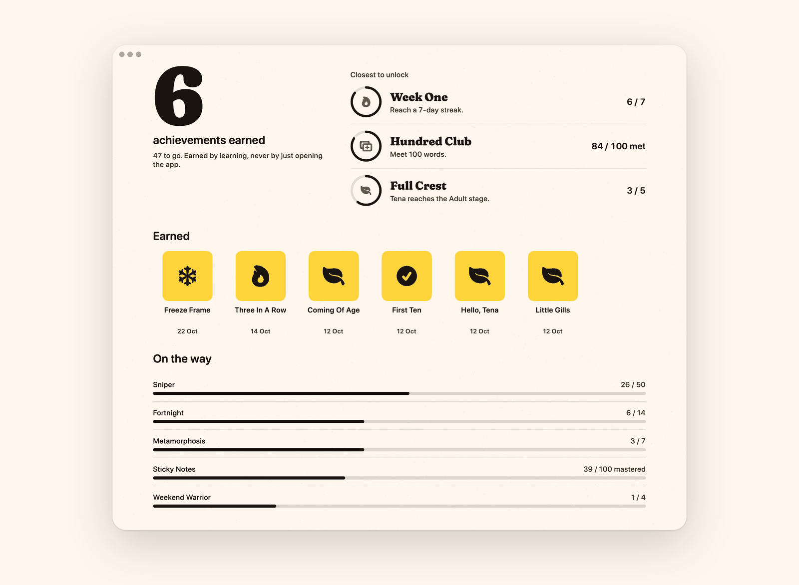<br><sub><b>Achievements.</b> The closest ones to unlock come first.</sub></td>
  </tr>
</table>

<p align="center">
  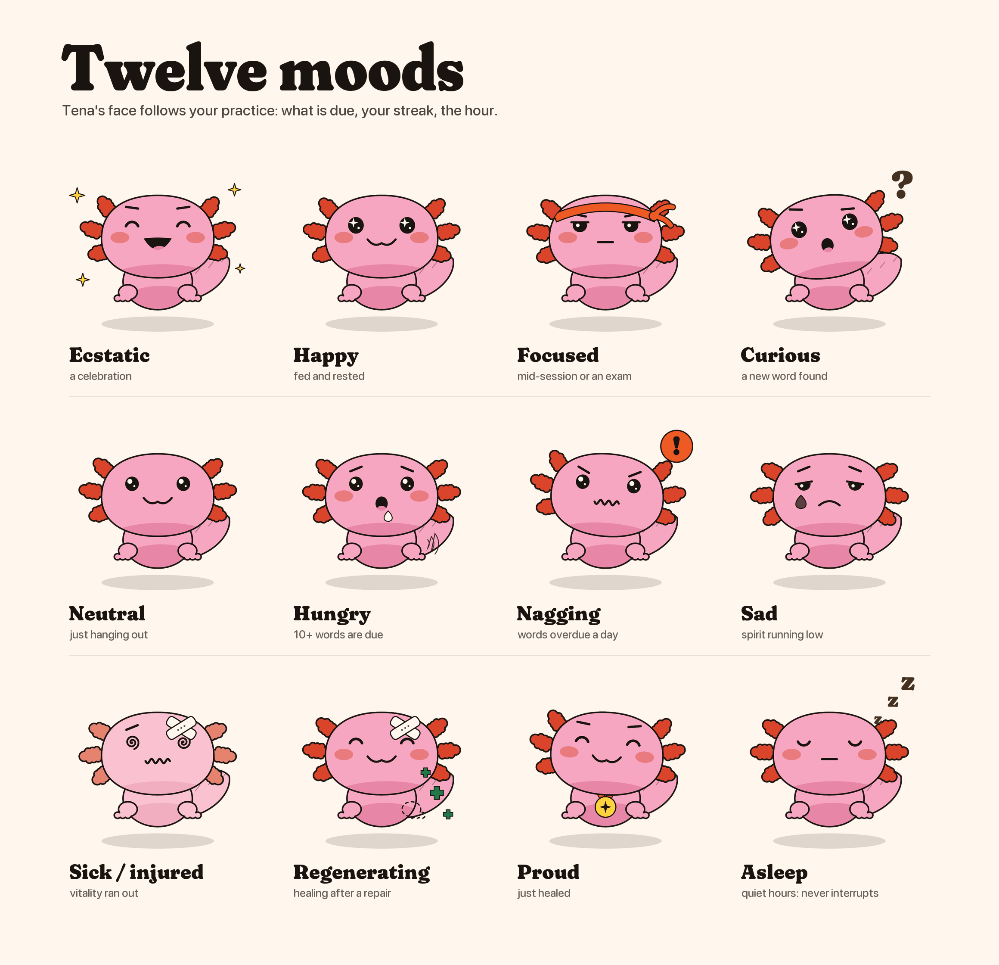
</p>

<details>
<summary>Dark mode</summary>
<br>
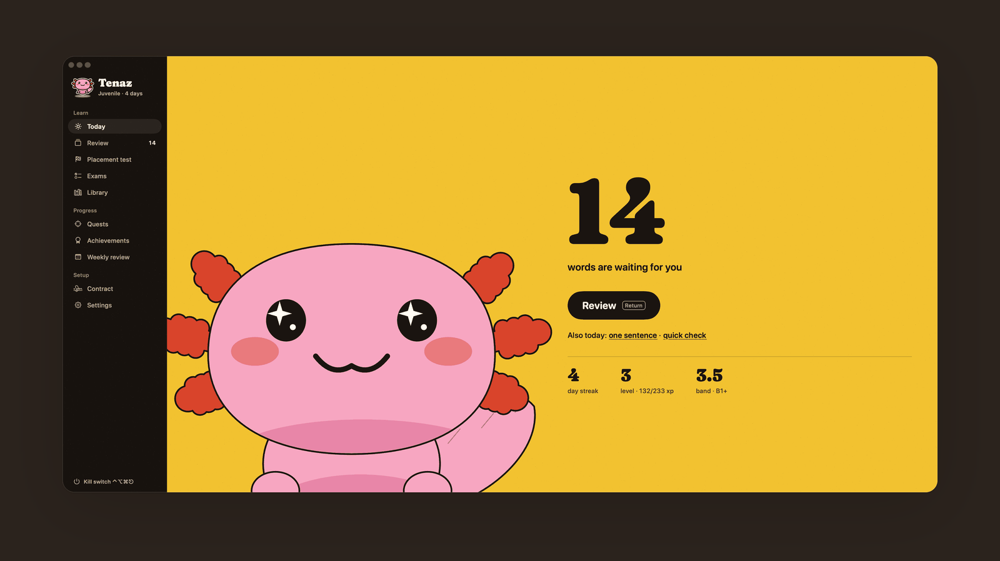
</details>

## Safety by design

Tenaz interrupts you on purpose, so the limits are hard rules, written down in [DECISIONS.md](DECISIONS.md) and checked by tests and self-tests.

| Rule | How it is enforced |
|---|---|
| Nothing intrusive is on until you turn it on | `overlaysEnabled` and `gateEnabled` default to `false`. Every penalty rule ships off. |
| One hotkey turns everything off | **Ctrl+Opt+Cmd+Esc** closes every surface and keeps intrusions off until 04:00. It uses a Carbon hotkey, so no Accessibility permission is needed. Cmd+Opt+Esc stays free for Force Quit. |
| It can be turned off without the UI | `defaults write com.chere3.tenaz killSwitch -bool true`, or create the file `~/Library/Application Support/Tenaz/DISABLE_OVERLAYS`. |
| Nothing stays on screen forever | Watchdogs close an overlay after 90 s and the gate after 5 min, whatever the UI is doing. |
| Never during a meeting | Camera or microphone in use, a meeting app in front, a calendar event, a presentation, or Focus all defer. A sensor that can't be read counts as busy. A visible overlay or gate is checked every second and closes for free when a meeting starts. |
| Never locks you out | The gate is a window shown after unlock, not a login replacement. Emergency skip is always available. Force Quit always works, and nothing relaunches Tenaz. |
| Quiet nights | Nothing appears between 22:30 and 08:00. |
| Your data stays local | One SQLite file in `~/Library/Application Support/Tenaz`. No account, no telemetry, no server. |
| No API keys | Claude is reached only through your own `claude` CLI session. The child process environment drops `ANTHROPIC_API_KEY`. Reviews, overlays, the gate and objective exam items all work without Claude. |

Tenaz is not sandboxed. It needs to launch `claude`, see which app is in front, and read Tivra's database. [SECURITY.md](SECURITY.md) explains the scope.

## Build from source

There is no prebuilt binary yet. The app is not notarized.

**Requirements**
- macOS 26 and Xcode 26 (Swift 6.2)
- [XcodeGen](https://github.com/yonaskolb/XcodeGen) 2.38 or newer: `brew install xcodegen`
- Optional: [Claude Code](https://docs.anthropic.com/en/docs/claude-code) logged in with a claude.ai account, for grading writing and speaking. Tenaz looks for it only at `~/.local/bin/claude`.

**Build and run**

```bash
git clone https://github.com/Chere3/tenaz.git
cd tenaz
xcodegen generate                 # creates Tenaz.xcodeproj; never edit it by hand
open Tenaz.xcodeproj              # pick your team under Signing, then Run
```

`project.yml` carries the author's `DEVELOPMENT_TEAM`. From the command line, pass your own:

```bash
xcodebuild -project Tenaz.xcodeproj -scheme Tenaz -configuration Debug \
  -derivedDataPath .derived build DEVELOPMENT_TEAM=<your-team-id>
open .derived/Build/Products/Debug/TenazDev.app
```

Use `CODE_SIGNING_ALLOWED=NO` instead if you only want to check that it compiles. That is what CI does.

The Debug build is `TenazDev.app` (`com.chere3.tenaz.dev`) and keeps its data in `~/Library/Application Support/TenazDev`. For it, the kill-switch `defaults` domain is `com.chere3.tenaz.dev`. Tenaz lives in the menu bar and shows a Dock icon only while its main window is open.

**Tests**

```bash
swift test    # 263 tests in 35 suites for TenazCore
```

**Render any screen to PNG** (no permissions needed):

```bash
.derived/Build/Products/Debug/TenazDev.app/Contents/MacOS/TenazDev \
  --tenaz-snapshot popover --out .derived/shots/popover.png
```

Screen names are in [`Tenaz/App/SnapshotRegistry.swift`](Tenaz/App/SnapshotRegistry.swift).

**Install a Release build on your own Mac**

[`scripts/install-tenaz.sh`](scripts/install-tenaz.sh) builds a signed Release, copies it to `/Applications/Tenaz.app` and turns on "open at login". It is the author's installer: it checks the signing team, so change `EXPECTED_TEAM` in the script and `DEVELOPMENT_TEAM` in `project.yml` first. On the first install it copies your TenazDev data and preferences. Set `TENAZ_COPY_PREFS=safe` to keep the overlay and gate switches off in the new copy.

### Optional: neural voices

Listening works out of the box with the system voice. For the Kokoro voices, render the audio cache once (Python 3.12 through [uv](https://docs.astral.sh/uv/)):

```bash
cd scripts/tts
uv run python render.py --limit 30                                         # quick test
uv run python render.py                                                    # everything, into the TenazDev cache
uv run python render.py --cache ~/Library/Application\ Support/Tenaz/audio-cache   # for the Release build
```

The script downloads the Kokoro model files to `~/.cache/tenaz/kokoro/` (or `$TENAZ_KOKORO_DIR`) if they are missing. It is incremental and skips lines already rendered. A full render takes hours and several hundred MB. `--tenaz-selftest audio` reports the coverage.

## Architecture

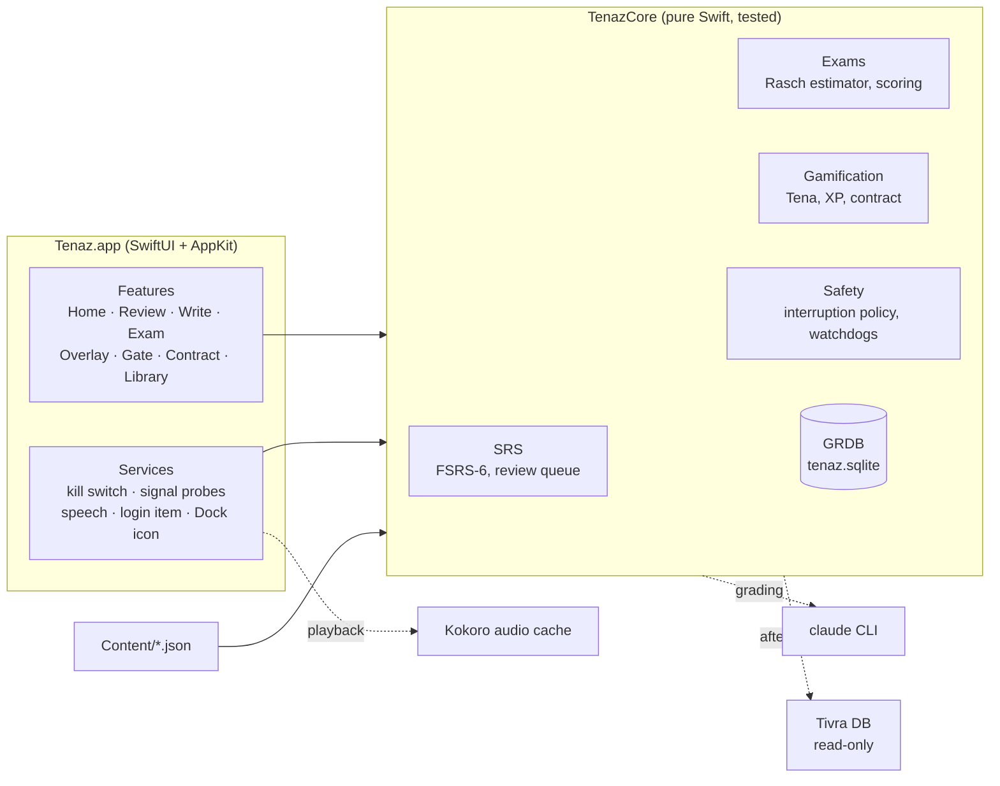

`TenazCore` has no SwiftUI or AppKit imports, so the scheduling, scoring, safety and penalty rules are all unit-tested. Its one third-party dependency is [GRDB](https://github.com/groue/GRDB.swift). The app target builds with strict concurrency and MainActor default isolation.

```
tenaz/
├── Sources/TenazCore/    SRS, Exams, Gamification, Safety, Claude, Tivra, Integrity,
│                         Speech, Exposure, Library, Progress, Persistence, Design, Content
├── Tenaz/
│   ├── App/              entry point, snapshot / smoke / self-test launch modes
│   ├── Features/         Home, Review, Write, Exam, Overlay, Gate, Intrusions, Contract,
│   │                     Mascot, Popover, Progress, Library, Onboarding, Settings, Shell, Gallery
│   ├── Services/         safety probes and kill switch, speech, login item, Dock icon
│   └── Shared/           Full Bleed design system
├── Content/              items/, vocab/, config/, achievements, catalog, licences
├── Tests/TenazCoreTests/ Swift Testing suites and fixtures
├── scripts/              verify.sh, install-tenaz.sh, tts/, ingest/, fsrs-fixtures.py
└── docs/                 PLAN.md, research/, design/, proposals/
```

The full spec, data model and milestones are in [docs/PLAN.md](docs/PLAN.md). The visual language is [docs/design/full-bleed.md](docs/design/full-bleed.md).

## Research

Each design choice traces back to a written report. Claims are tagged when they could not be checked against a primary source.

| Report | Question it answers |
|---|---|
| [01 ADHD psychology](docs/research/01-adhd-psychology.md) | How can an app be intrusive without making an ADHD learner quit? |
| [02 Gamification and mascot](docs/research/02-gamification-mascot.md) | What actually works in Duolingo, Finch, Habitica and Forest, and how should Tena grow? |
| [03 Learning science](docs/research/03-learning-science.md) | What should a Spanish-speaking B1+ adult practice, and how should it be spaced? |
| [04 Exams and CEFR](docs/research/04-exams-cefr.md) | How is the 2026 TOEFL iBT built and scored, and how do bands map to CEFR and IELTS? |
| [05 macOS mechanics](docs/research/05-macos-mechanics.md) | Which macOS 26 APIs make overlays and the gate possible, and which are off-limits? |
| [06 Tivra integration](docs/research/06-tivra-integration.md) | How can exams be witnessed by reading another app's data without writing to it? |
| [07 Competitors](docs/research/07-competitors.md) | What do existing language apps do, and what evidence backs them? |
| [08 Content and books](docs/research/08-content-books.md) | Which open datasets, graded readers and podcasts fit, and under what licences? |
| [10 Swift practices](docs/research/10-swift-practices.md) | How should a Swift 6 macOS app like this be structured and tested? |
| [11 Design system](docs/research/11-design-system.md) | ADHD-first UI research. Its visual direction was later replaced by [Full Bleed](docs/design/full-bleed.md). |

## Content and licences

- **Code and Tenaz-original content:** MIT, see [LICENSE](LICENSE).
- **Third-party and derived content** keeps its own licence. Sources include OneStopEnglish, OneStopQA, Belebele, OpenStax, Tatoeba, Common Voice, Taskmaster, MultiWOZ, Cosmos QA, args.me, Dolly and the NGSL family of word lists. Some files are CC BY-SA and must stay share-alike. The per-file table is [Content/LICENSES.md](Content/LICENSES.md), generated from `Content/licenses.json`.
- **Not in this repository:** non-commercial and unclear-licence sources. They use the `*.nc.json` suffix, are gitignored, and exist only in local builds.
- **Font:** [Fraunces](https://github.com/undercasetype/Fraunces), SIL Open Font License 1.1 ([licence file](Tenaz/Resources/Fonts/Fraunces-OFL.txt)).

## Roadmap

Built and working today: everything above. Still open:

- [ ] Sound palette
- [ ] Data export and automatic backups
- [ ] Import your own books and measure word coverage
- [ ] Tivra re-checks at +90 s and +15 min after an exam
- [ ] Polish for the split weekly and monthly mock flows
- [ ] Spoken answers tested end to end with a microphone (typed answers are the default)
- [ ] A notarized download

Ideas and open product questions are listed in [docs/PLAN.md §7](docs/PLAN.md#7-open-questions-owner-decisions).

## Contributing

Issues and pull requests are welcome. Start with [CONTRIBUTING.md](CONTRIBUTING.md): it covers setup, signing, snapshots, and the safety rules every PR must keep. Please follow the [Code of Conduct](CODE_OF_CONDUCT.md). Report vulnerabilities privately as described in [SECURITY.md](SECURITY.md).

Good first areas: content quality fixes (with a licence entry), new snapshot-tested screens, and tests for `TenazCore`.

## Acknowledgements

- [FSRS](https://github.com/open-spaced-repetition) by the Open Spaced Repetition project. py-fsrs is the oracle for Tenaz's test fixtures.
- [GRDB.swift](https://github.com/groue/GRDB.swift) by Gwendal Roué.
- [Fraunces](https://github.com/undercasetype/Fraunces) by Undercase Type.
- [Kokoro-82M](https://huggingface.co/hexgrad/Kokoro-82M) (Apache-2.0), run through [kokoro-onnx](https://github.com/thewh1teagle/kokoro-onnx).
- The dataset authors credited in [Content/LICENSES.md](Content/LICENSES.md).

## License

Code is released under the [MIT License](LICENSE). Content files keep the licences listed in [Content/LICENSES.md](Content/LICENSES.md).

TOEFL is a registered trademark of ETS; IELTS and Aptis are trademarks of their respective owners. Tenaz is not affiliated with or endorsed by them.
